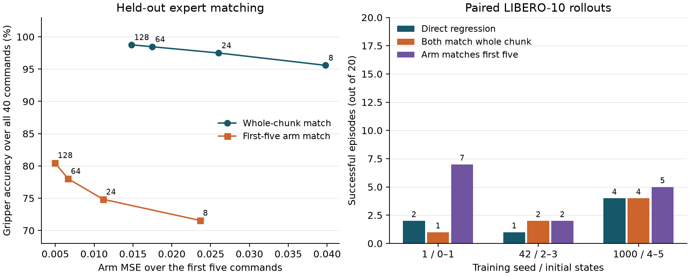

# LIBERO-10 单步操作策略 · 2026-11-20

在全部十项任务的 60 个配对回合中，机械臂按即将执行的五步选择示范、夹爪按整段选择示范，成功 14 次。同参数量的整段匹配对照成功 7 次。净增的 7 次成功有 6 次来自第一组种子和初态。

## 策略与对照

所有版本使用同一冻结的 GR00T N1.7 视觉塔。两幅 128×128 图像各保留四个区域的特征，与八维机械臂和夹爪状态、已知任务编号一起输入两层 MLP。动作头从随机权重训练，一次前向同时给出 40 步六维机械臂相对命令与夹爪命令。部署时执行前五步，再读传感器。训练数据、标准化和模板均按示范回合划分。实现可通过 LeRobot 的 LIBERO 环境运行，训练使用本目录所列研究入口。[动作头](../../src/lerobot/policies/demonstration_chunk/modeling_demonstration_chunk.py) · [训练入口](../../scripts/one_step/train_demonstration_chunk.py) · [闭环入口](../../scripts/one_step/eval_libero.py)

| 版本 | 机械臂 | 夹爪 |
| --- | --- | --- |
| `direct` | 直接回归 40×6 | 每一步独立预测开合 |
| `medoid` | 选一个示范动作块 | 使用同一块的开合序列 |
| `arm` / `arm_grip` | 在所选示范上加连续修正 | 前者保留示范开合，后者另学逐步修正 |
| `soft_arm` | 按学习到的概率加权平均模板并修正 | 使用概率最高的整段模板 |
| `dual_full` / `dual_prefix` | 独立选择器对模板加权并修正。前者用整段匹配标签，后者用前五步机械臂标签 | 两者均使用独立的整段模板选择器 |
| `event_time` / `event_occupancy` | 直接回归 40×6 | 均预测初始符号和首次切换时间的分布。前者监督事件时刻，后者监督各时刻的开合概率 |

每个任务用 24 个实际训练窗口作模板。按五步分块后，将六维机械臂命令均值与夹爪符号均值分别展开，所得距离为两组坐标的均方差之和，夹爪项权重为 0.35²。从最靠近任务均值的样本开始，用最远点补齐模板，再做八轮分配与组内代表样本更新。推理仅读取已保存的模板表。两种双选择器拥有相同参数量、数据和损失权重，唯一设计差别是机械臂选择器的监督标签。

事件头输出初始夹爪取正的概率 (p) 和首次切换时间的分布。令 (F(t)) 是截至第 (t) 步已切换的概率，另设“块内无切换”一类。连续输出为 ((2p-1)(1-2F(t)))，所有时刻可以并行计算，取符号后每块至多切换一次。多次切换的窗口在训练集中占 203/12,006，在留出集中占 35/2,968。模型每五步重规划，整回合可以多次开合。

## 时序核查

原始 HDF5 将动作执行后的观测记作同下标的 `obs[t]`。输入该观测时，首个训练标签应为 `actions[t+1]`。用全部十个任务的 `demo_0` 在第 40 和 80 帧复原仿真器，`states[t]` 与 `obs[t-1]` 的末端位置差中位数为 0.215 mm，与 `obs[t]` 比是 4.80 mm。修正了缓存和闭环校准，重新训练所有报告版本。早先三任务 DrifOv 与本轮未校正试跑使用同下标标签，不能直接并表。[时间偏移实测](timing_probe.json) · [上游 HDF5 生成](https://github.com/Lifelong-Robot-Learning/LIBERO/blob/master/scripts/create_dataset.py#L164-L211)

## 只改变匹配标准会损失什么

核对了 10 个任务的全部 240 个模板，诊断重建结果与部署权重逐项相同（每任务 24 个时）。在同一批留出窗口上，给选择器直接看专家未来动作，分别按整段混合距离和前五步六维机械臂 MSE 找最近示范。表中数字为十任务宏平均。这个诊断测量选定字典与匹配标准的代价，部署时没有专家未来动作。[逐任务字典诊断](dictionary.json) · [诊断脚本](../../scripts/one_step/probe_chunk_dictionary.py)

| 每任务模板数 | 前五步 MSE，整段匹配 | 前五步 MSE，前缀匹配 | 两者选同一模板 | 整段夹爪准确率，整段 / 前缀匹配 |
| ---: | ---: | ---: | ---: | ---: |
| 8 | 0.0398 | 0.0236 | 46.1% | 95.6% / 71.6% |
| 24 | 0.0260 | 0.0112 | 35.6% | 97.5% / 74.8% |
| 64 | 0.0175 | 0.0066 | 27.3% | 98.5% / 78.0% |
| 128 | 0.0148 | 0.0050 | 21.2% | 98.8% / 80.5% |

增加模板数改善了两种准则各自的重建能力，同时它们选中同一模板的比例继续下降。这解释了为何要检验两套选择器。它还不能证明任务轨迹落在某个光滑流形上。BeT 已有“离散选择加连续修正”，ACT 已将动作分块用于精细操作。这里考察的具体问题是执行时域与夹爪时域能否共享匹配标准。[BeT，NeurIPS 2022](https://papers.neurips.cc/paper_files/paper/2022/hash/90d17e882adbdda42349db6f50123817-Abstract-Conference.html) · [ACT，RSS 2023](https://arxiv.org/abs/2304.13705)

## 闭环与留出结果

每任务 50 条示范按固定种子划为 40 条训练、10 条留出。窗口步幅 8，12,006 个训练窗口、2,968 个留出窗口。每个模型训练 1,800 次更新，batch 128。固定 H=40、K=5，每回合最多 520 个控制步。训练种子 1、42、1000 分别在每任务的初态 0–1、2–3、4–5 上评测。同一列各模型的初态观测指纹逐回合相同；跨列同时改变了训练种子与初态。MSE 和切换 F1 按任务、再按该版本已有的种子等权平均。F1 对有方向的切换做 ±1 步一对一匹配。

| 版本 | 种子 1（/20） | 种子 42（/20） | 种子 1000（/20） | 前五步机械臂 MSE | 夹爪切换 F1 |
| --- | ---: | ---: | ---: | ---: | ---: |
| `direct` | 2 | 1 | 4 | 0.0167 | 0.187 |
| `medoid` | 2 | — | — | 0.0296 | 0.144 |
| `arm` | 1 | 1 | — | 0.0282 | 0.152 |
| `arm_grip` | 1 | — | — | 0.0287 | 0.186 |
| `soft_arm` | 5 | 1 | 3 | 0.0223 | 0.153 |
| `event_time` | 1 | 2 | — | 0.0266 | 0.178 |
| `event_occupancy` | 3 | 1 | — | 0.0171 | 0.151 |
| `dual_full` | 1 | 2 | 4 | 0.0223 | 0.154 |
| `dual_prefix` | 7 | 2 | 5 | 0.0185 | 0.157 |

与 `dual_full` 相比，`dual_prefix` 在 30 个任务×种子组合中均降低前五步误差，宏平均降低 16.7%。60 个配对回合中，新方法独自成功 9 次，对照独自成功 2 次。依次分组的净差为 +6、0、+1。直接回归机械臂的离线误差最低，闭环为 7/60。将这些结果作为匹配准则的证据；种子和初态共同变化，成功率增量的大小仍不稳定。事件时间头在两个种子下共 3/40，按开合概率监督为 4/40，同组直接回归为 3/40。精确切换时间监督还增加了共享网络的机械臂预测误差，两种事件损失的梯度竞争有待单独测量。

共训练 20 个模型，完成 400 个策略回合，各任务从自己的初始示范状态回放原动作，10/10 成功。校准时最大状态坐标绝对差 0.00208，两路相机各任务的最大平均像素差为 7.52 灰度级以内（0–255）。九种动作头均验证一次前向返回 40×7，事件头输出在每个块内至多变号一次。[逐回合与逐任务结果](results.json) · [专家回放](expert.json) · [配对汇总脚本](../../scripts/one_step/summarize_chunk_runs.py)



## 论文问题

在固定 H=40 时，改变实际执行长度 K，机械臂选择器的最佳匹配时域是否跟随 K？下一项区分机制的实验可固定训练种子与初态的全交叉组合，独立改变执行步数和训练匹配步数。若两者对齐时收益可复现，才有依据把“执行时域决定局部动作距离”推广到 K=5 以外。夹爪准确率测量命令符号，实际接触和持物仍需物体状态观测来检验。

## 复现

在 `lerobot-gpu:/root/autodl-tmp/lerobot` 运行，完整权重位于 `outputs/chunk_aligned/seed{1,42,1000}`。下面以种子 1 的分时域选择器为例。可按 GPU 分配不同训练和评测进程，日志重定向到所用结果目录。

```bash
run=outputs/chunk_aligned
suite=/root/autodl-pub/datasets/libero/libero_10
groot=/root/autodl-pub/checkpoints/groot/n1.7-3b
uvbin=/root/autodl-tmp/lerobot-env/bin/uv
export CUDA_VISIBLE_DEVICES=0 OMP_NUM_THREADS=2 HF_HUB_OFFLINE=1
export HF_HUB_DISABLE_PROGRESS_BARS=1
# 从原始示范重建；已有校正缓存时从训练命令开始。
"$uvbin" run --no-sync python scripts/one_step/cache_libero.py --all-tasks \
  --action-offset 1 --suite "$suite" --checkpoint "$groot" --out "$run/cache"
"$uvbin" run --no-sync python scripts/one_step/train_demonstration_chunk.py \
  --cache "$run/cache" --variant dual_prefix --seed 1 --out "$run/seed1"
export MUJOCO_GL=egl PYOPENGL_PLATFORM=egl MUJOCO_EGL_DEVICE_ID=0
export PYTHONPATH=scripts/latency_test
export LD_LIBRARY_PATH=/root/autodl-tmp/libero-runtime/egl/usr/lib/x86_64-linux-gnu
export __EGL_VENDOR_LIBRARY_FILENAMES=/root/autodl-tmp/libero-runtime/egl/vendor/10_nvidia.json
"$uvbin" run --no-sync python scripts/one_step/eval_libero.py \
  --root "$run/seed1" --variant dual_prefix --seed 1 --first-state 0 --episodes 2 \
  --suite "$suite" --checkpoint "$groot" --out "$run/seed1/dual_prefix-s0" \
  --libero-assets /root/autodl-tmp/libero-runtime/LIBERO-master/libero/libero/assets
"$uvbin" run --no-sync python scripts/one_step/probe_chunk_dictionary.py \
  --cache "$run/cache" --out "$run/dictionary.json"
"$uvbin" run --no-sync python scripts/one_step/summarize_chunk_runs.py \
  --root "$run" --episodes-per-task 2 --out "$run/results.json"
```
