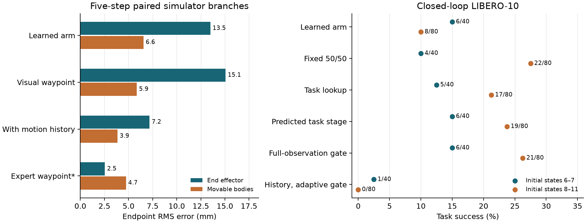

# LIBERO-10：机械臂与夹爪分工，以及学习策略与模型控制的切换

## 实测结果

1,660 个策略回合覆盖 10 项任务与 60 个不同任务初态，种子 1、42 在同一初态横向配对。初态 6–7 每组 40 回合；第二批的 40 回合组用初态 8–9，80 回合组用初态 8–11。每行分母按实际试验列出。结果均属 1,800 次专家更新下的短程试验。

| 方法 | 初态 6–7 | 初态 8 起 | 合计 |
| --- | ---: | ---: | ---: |
| `dual_prefix` | 8/40 | 6/40 | 14/80 |
| `separate_prefix` | 6/40 | 9/40 | 15/80 |
| `grip_binary` | 5/40 | 11/40 | 16/80 |
| `grip_event` | 6/40 | 7/40 | 13/80 |
| `dual_prefix-grip-separate_prefix` | 5/40 | — | 5/40 |
| `separate_prefix-grip-dual_prefix` | 7/40 | — | 7/40 |

32 条示范拟合专家的控制器对照如下。

| 方法 | 初态 6–7 | 初态 8 起 | 合计 |
| --- | ---: | ---: | ---: |
| `learned` | 6/40 | 8/80 | 14/120 |
| `servo` | 2/40 | — | 2/40 |
| `adaptive` | 8/40 | — | 8/40 |
| `outcome_constant` | 6/40 | 16/80 | 22/120 |
| `always_half` | 4/40 | 22/80 | 26/120 |
| `outcome_task` | 5/40 | 17/80 | 22/120 |
| `outcome_phase` | 6/40 | 19/80 | 25/120 |
| `outcome_context` | 6/40 | 21/80 | 27/120 |
| `history_servo` | 0/40 | — | 0/40 |
| `history_half` | 0/40 | — | 0/40 |
| `history_constant` | 0/40 | 0/80 | 0/120 |
| `history_adaptive` | 1/40 | 0/80 | 1/120 |
| `history_aligned` | — | 2/40 | 2/40 |
| `history_matched` | — | 1/40 | 1/40 |

固定半数平移权重成功 26/120，完整观测路由 27/120，按任务阶段选比例 25/120，纯学习 14/120。单帧目标配合伺服时，局部末端 RMS 误差约 15 mm；运动历史修正将它降至约 7.2 mm，而历史自适应路由的任务成功数降到 1/120。保持控制律和旋转夹爪不变，提供专家分支的真实终点，末端 RMS 误差约 2.5 mm。[逐项配对与局部误差](summary.json) · [逐回合、干预原始数据和权重校验](evidence.tar.gz) · [复现](REPRODUCE.md)

## 设计

**分离执行器。** 使用十项任务、每项 40 条训练示范。对照 `dual_prefix` 共用可训练的视觉投影和两层 MLP，机械臂、夹爪各有选择器。实验组 `separate_prefix` 连投影和 MLP 都独立，保留相同的模板、监督与 1,800 次更新。两组可训练参数分别为 599,392 和 598,880；冻结的 GR00T 双视角编码器共用。另用两种专门的夹爪策略替换独立组的夹爪，固定六轴机械臂权重：`grip_binary` 逐步监督开合，`grip_event` 监督块内最多一次切换的开合概率。两个交叉换头实验还把共享组的夹爪与独立组的机械臂互换。[独立网络](../../src/lerobot/policies/demonstration_chunk/modeling_demonstration_chunk.py) · [夹爪策略](../../src/lerobot/policies/demonstration_chunk/gripper_control.py)

**组合控制器。** 在另一组对照中，每任务分为 32 条示范拟合策略和动力学、8 条校准路由、10 条留出。所有路由使用完全相同的两位专家。学习专家预测整段动作；几何控制器使用拟合的三维笛卡尔模型，视觉网络预测下一个五步终点。每五个控制周期只做一次神经规划；块内每周期用最新末端位置重算平移命令。仅三维平移参与混合，旋转和夹爪一路使用冻结的学习专家，底层仍为 LIBERO 的操作空间控制器。运行策略只读图像、末端/夹爪状态和任务 ID。阶段模型从观测预测任务 BDDL 目标谓词的真值组合，仿真真值只参与监督和评测。[控制器与路由](../../src/lerobot/policies/demonstration_chunk/hybrid_control.py) · [逐周期反馈](../../src/lerobot/policies/demonstration_chunk/waypoint.py)

模型按行向量约定拟合五步关系 `Δx ≈ (Σ u) B`。对目标位置 `g`、当前位置 `x` 和剩余步数 `n`，伺服命令为 `clip((g−x) B⁺ / n)`。学习命令和伺服命令分别限幅后，以块内固定权重相加。十任务留出示范的五步位移模型 R² 为 0.922。`history_*` 只替换规划的首个终点，线性拟合使用原网络预测与最近两个实测控制周期的位移。复位时将缺失历史置零，之后每周期仅用已发生的位移更新。

## 三种监督到底要求切换器学什么

1. **专家命令。** 比较纯学习、纯伺服、全局常数、每任务常数、随观测变化的连续权重及其硬阈值版。常数直接解约束最小二乘，连续路由在校准示范上最小化前五步平移命令 MSE。
2. **五步物理结果。** 每个校准和留出示范分六段，各抽一个时间点。从带有同一求解器和控制器状态的 MuJoCo 进程分支，分别执行专家命令以及两种训练种子在权重 0、0.5、1 时的命令。代价为相对专家分支的末端位置平方距离，加上可动非机器人刚体标记点平方距离的均值，单位 m²。每个刚体使用中心与距中心 5 cm 的三个轴向标记。校准与留出分别有 480 和 600 个状态。全局、按任务、按预测谓词组合的规则均从校准代价选择比例；任务与谓词表各用 12 个上一级均值样本作收缩。完整观测路由用小网络预测三个代价。五步物理结果只衡量跟随局部示范的质量。[分支运行](../../scripts/one_step/control_interventions.py) · [路由拟合](../../scripts/one_step/train_outcome_router.py)
3. **完整任务。** 上述模型在同一组官方 LIBERO 初态闭环运行，使用环境原生成功判据。训练种子 1 与 42 交叉使用相同初态，每项任务每状态只运行一次。记录每个回合的初态指纹、成功、步数，以及混合控制器每次重规划时的实际谓词位掩码、伺服权重和第一个夹爪命令。谓词真值可以在执行中反复改变；它与接触、持物状态及操作者意图各有不同含义。

**相关研究。** Johannink 等将传统控制与学习残差结合；GUAPO 利用不确定性组合模型控制和学习策略。这里固定专家并实测相同仿真状态下不同混合权重的后果，以区分路由学到了什么。[Residual RL，ICRA 2019](https://arxiv.org/abs/1812.03201) · [GUAPO](https://arxiv.org/abs/2005.10872)

## 解释边界

从专家状态分支可测出一个控制器改善局部跟踪的空间。给伺服器输入同一模拟器中专家分支五步后真实到达的位置，仅用作离线诊断，部署策略始终预测自身的目标。重复运行的学习专家分支可用于检查求解器状态和回放一致性。在闭环里，运动历史来自策略自己先前执行的命令，因而示范状态上的局部误差无法直接预测任务成功率。

执行阶段实验保留了一个重要对照：在种子 1 上，按校准集选五步结果最优的常数恰为 0.5，相同回合同时作为固定 50/50 基线；在种子 42 上，校准集选出 0，因此额外实际运行固定 50/50。两者在统计和实验总数中分别计量。阶段表将一个任务拆成已满足谓词组合，状态稀少时回退到任务均值。任务只规定最终条件，示范者打算下一步操作哪个物体没有独立标注。

运动方向门控尝试保留从静止启动的能力：先计算最近一步位移按五步外推后，在单帧视觉目标方向上的投影比例，使用校准的终点噪声对分母正则化，再将比例限于 [0,1]，乘以运动历史路由权重。同时评测使用校准集平均门控强度的常数对照。[方向门控校准](../../scripts/one_step/calibrate_motion_gate.py)
