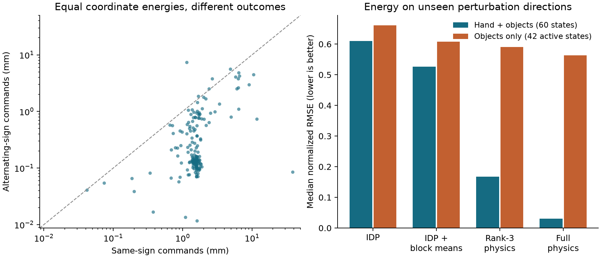

# LIBERO-10 上的操作几何：动作方向、物体后果与扰动尺度

2026-11-20 · 10 个任务、每任务 2 条专家示范、每条示范 3 个状态，共 60 个状态。本研究检验局部度量对任务后果的预测，无策略训练。所有结论针对 16 步平移命令扰动、指定后果映射及 LIBERO 步进仿真。

## 主要结果

1. **逐坐标误差相同的动作可以产生不同的物理后果。** 每个状态分别沿 x/y/z 做一对控制：四段连续同向偏移，或每四步交替反向。两者逐坐标平方完全相同。在 180 对探测中，同向扰动在 175 对产生更大的末端与物体联合响应，在 148 对中响应幅度超过交替扰动的两倍。该有限幅度反例对任何固定对角二次型都成立。
2. **局部敏感性谱集中。** 12 维子空间内，累计解释联合度量 90% 谱能量所需方向数中位数为 3，范围为 1–5。在动作范数相同、单列范数至少为 1 的基底上实测拟合最强与最弱方向，半径 0.01 下的联合响应幅度中位数分别为 429.3 和 1.5 μm。该数值是两个状态分布的中位数；秩 3 的谱截断仍使用所有 12 个拟合方向。
3. **末端可预测性和物体可预测性差异明显。** 半径 0.04 下完整物理度量对联合后果与仅物体后果的方向排序 Spearman 中位数分别为 0.997 和 0.706，IDP 分别为 -0.028 和 0.021。另一条示范相同阶段的直接迁移分别为 0.825 和 0.262。
4. **物体敏感性与操作阶段有关。** 按拟合方向的 RMS 响应至少 1 μm 筛选，夹爪切换前 2/20 个状态、跨切换 20/20、切换后 20/20 个状态具有可辨物体响应。本条计数依据物体位置响应。早期归档中的机器人–环境接触序列使用了跳过无名几何体的名称列表下标，接触分类计数撤回；脚本已改为按名称解析真实 MuJoCo ID。[几何 ID 核查](../visual_geometry/README.md)



## 未参与拟合的方向

固定拟合半径 0.02，验证半径 0.04。在每个状态用 12 个坐标方向的正负两侧差分构造 J。对 12 个独立随机单位方向，目标值为双侧后果偏差平方范数的均值除以扰动半径平方。误差为该状态 12 个方向上的 RMSE 除以其平均目标值，表内为跨状态中位数；数值可以超过 1。末端与物体合成后果时有隐含权重，因此另列两个分量。顺序为联合、末端与物体。

| 度量 | 联合（60） | 末端（60） | 物体（42 个活跃状态） |
| --- | ---: | ---: | ---: |
| 动作欧氏距离 | 0.606 | 0.605 | 0.664 |
| IDP 对角度量 | 0.610 | 0.610 | 0.661 |
| IDP + 5/20 步分段均值 | 0.527 | 0.487 | 0.608 |
| 实测物理度量，仅取对角线 | 0.636 | 0.611 | 0.646 |
| 实测物理度量，秩 3 | 0.168 | 0.149 | 0.591 |
| 实测物理度量，完整 | 0.030 | 0.022 | 0.564 |
| 同任务、同阶段的另一条示范的物理度量 | 0.382 | 0.227 | 1.099 |

欧氏、IDP 和分段均值均获得同状态物理度量的迹作尺度校准，仅检验形状。物理度量直接预测能量，跨示范迁移不使用目标状态的物理校准。物理对角项来自 12 维分段命令空间。对物体响应的筛选只看拟合探测。将阈值由 1 提高到 10 / 100 μm 时分别保留 40 / 37 个状态，完整物理度量中位误差分别为 0.564 / 0.554。

## 尺度复验

对每个验证半径重新用 12 个坐标方向拟合雅可比，再评估完全相同的独立随机方向。“同半径”与“固定”共用上表的活跃状态，避免选择样本带来的差异。

| 验证半径 | 末端，固定拟合 | 末端，同半径 | 物体，固定拟合 | 物体，同半径 |
| --- | ---: | ---: | ---: | ---: |
| 0.01 | 0.026 | 0.035 | 0.893 | 0.744 |
| 0.04 | 0.022 | 0.026 | 0.564 | 0.575 |
| 0.16 | 0.037 | 0.026 | 1.101 | 0.635 |

在最大半径，同尺度拟合把物体误差从 1.101 降至 0.635，表明尺度失配解释了一部分误差。中等半径同尺度拟合时物体误差仍为 0.575，末端为 0.026。现有观测支持分别建模手与物体的局部敏感性，尚不能据此判定不可微性或唯一的接触机制。

## 实验边界与复现

- 取每项任务的 `demo_0`、`demo_1`。以第一个具有完整上下文的闭合命令切换为锚点，无合适闭合点时用第一个合格开合切换。各段从切换前 24、前 4、后 12 步开始。阶段是指令相位。恢复示范 XML 和状态，在复原锚点前用真实命令预热控制器最多 3 步。恢复后机器人末端相对 HDF5 观测的位置差中位数为 4.7 mm，最大 12.2 mm；实验比较同一恢复状态的成对副本。
- 时间长度 H=16，四个互不重叠的 4 步块，每块独立扰动三个平移坐标；保持原旋转及夹爪命令。对靠近动作限幅的坐标对称缩小扰动基函数，避免裁剪造成虚假不对称。除最强/最弱方向检验显式统一动作向量范数外，半径单位为该 12 维命令基底的系数范数。
- 同一 CPU MuJoCo 进程在每个探测开始时 fork，继承物理、控制器和夹爪内部状态。60 个锚点上零扰动重复的最大后果偏差为 0；独立尺度批次重新运行了一个基向量探测，偏差均小于 1 nm。坐标拟合、随机方向验证和针对性方向验证分别保存。
- 后果取第 8、16 步的末端位置，以及可动非机器人 body 的 4 个刚体标记（原点和沿局部三轴各偏移 5 cm 的点）。标记距离平方按 body 与标记数取均值，再按两个时刻取均值；联合量将末端与物体项相加。包括带活动关节的 fixture。此选择只观测若干位姿后果，自由空间方向、旋转命令、接触冲量及整段动作空间的全局拓扑仍待研究。
- IDP 使用先前 LIBERO 三任务实验的冻结 GR00T 视觉塔和扩大版 DrifOv baseline seed 1 编码器，直接调用仓库的 `compute_geometry_excess`。在每个任务分别从余下示范中构造 4 个独立抽样的 31 条参考窗口，与查询各组成 32 样本批，平均四组对角权重。全长 40 步、空前缀，仅在探测的 16 步平移部分打分。已训练三项任务用已有任务 ID，其他七项使用零任务 ID。只看已训练三项时，联合 NRMSE 中位数仍为 IDP 0.645、秩 3 物理度量 0.165。
- 每个状态的各半径复用验证方向。每任务仅两条示范。低秩谱描述给定后果、基底和有限尺度下的敏感性，不能识别全局流形维度，也不证明混合动力学全域可微。完全物理模型每状态至少需要 24 条校准轨迹，跨示范复用衡量省去新探测的代价。

### 逐任务核查

| LIBERO 任务 | 状态数 | IDP 联合 NRMSE | 物理联合 NRMSE |
| --- | ---: | ---: | ---: |
| KITCHEN_SCENE3_turn_on_the_stove_and_put_the_moka_pot_on_it | 6 | 0.969 | 0.074 |
| KITCHEN_SCENE4_put_the_black_bowl_in_the_bottom_drawer_of_the_cabinet_and_close_it | 6 | 0.529 | 0.132 |
| KITCHEN_SCENE6_put_the_yellow_and_white_mug_in_the_microwave_and_close_it | 6 | 0.581 | 0.011 |
| KITCHEN_SCENE8_put_both_moka_pots_on_the_stove | 6 | 0.726 | 0.061 |
| LIVING_ROOM_SCENE1_put_both_the_alphabet_soup_and_the_cream_cheese_box_in_the_basket | 6 | 0.604 | 0.437 |
| LIVING_ROOM_SCENE2_put_both_the_alphabet_soup_and_the_tomato_sauce_in_the_basket | 6 | 0.674 | 0.269 |
| LIVING_ROOM_SCENE2_put_both_the_cream_cheese_box_and_the_butter_in_the_basket | 6 | 0.699 | 0.005 |
| LIVING_ROOM_SCENE5_put_the_white_mug_on_the_left_plate_and_put_the_yellow_and_white_mug_on_the_right_plate | 6 | 0.562 | 0.015 |
| LIVING_ROOM_SCENE6_put_the_white_mug_on_the_plate_and_put_the_chocolate_pudding_to_the_right_of_the_plate | 6 | 0.456 | 0.098 |
| STUDY_SCENE1_pick_up_the_book_and_place_it_in_the_back_compartment_of_the_caddy | 6 | 0.582 | 0.038 |

[仿真探测](../../scripts/operation_geometry/probe.py) · [示范几何](../../scripts/operation_geometry/expert_geometry.py) · [评分](../../scripts/operation_geometry/analyze.py) · [绘图](../../scripts/operation_geometry/figure.py) · [逐状态评分](scores.json) · [原始探测压缩包](probes.tgz)

在服务器 `/root/autodl-tmp/lerobot`，`outputs/opgeo/` 保留原始记录和日志。复算表图可在仓库根目录执行：

```bash
mkdir -p /tmp/libero-opgeo
tar -xzf Experiment-result/operation_geometry/probes.tgz -C /tmp/libero-opgeo
.venv/bin/python scripts/operation_geometry/analyze.py /tmp/libero-opgeo /tmp/libero-opgeo/scores.json
.venv/bin/python scripts/operation_geometry/figure.py /tmp/libero-opgeo/scores.json /tmp/libero-opgeo/geometry.png
```
