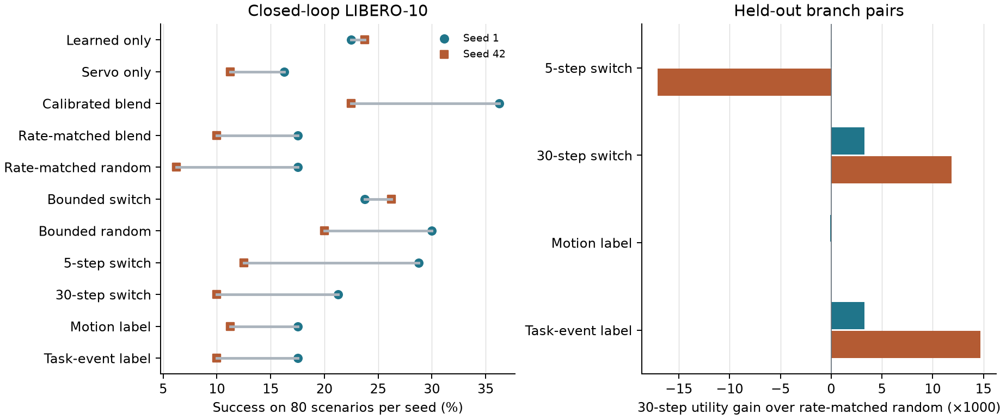

# 从策略实际访问的状态学习控制切换

## LIBERO-10 结果

11 种方法各评测相同的 160 个条件，共 **1,760 个完整闭环回合**。每个种子覆盖十项任务和八个官方初态。两个训练种子使用同一组 80 个任务初态；拟合、分支留出和闭环评测三组的初始观测指纹无交集。固定混合在两组预留初态上各成功 22/80、25/80。[配对、逐种子与逐任务结果](summary.json) · [逐回合和干预数据](evidence.tar.gz)

| 控制方法 | 种子 1（/80） | 种子 42（/80） | 合计（/160） |
| --- | ---: | ---: | ---: |
| 直接学习 | 18 | 19 | 37 |
| 全程伺服平移 | 13 | 9 | 22 |
| 示范校准的固定混合 | 29 | 18 | 47 |
| 5 步后果监督的硬切换 | 23 | 10 | 33 |
| 30 步后果监督的硬切换 | 17 | 8 | 25 |
| 硬切换频率对应的固定混合 | 14 | 8 | 22 |
| 匹配频率的随机硬切换 | 14 | 5 | 19 |
| 限制幅度的学习切换 | 19 | 21 | 40 |
| 匹配幅度与频率的随机切换 | 24 | 16 | 40 |
| 仅用 30 步物体距离监督 | 14 | 9 | 23 |
| 仅用 30 步任务事件监督 | 14 | 8 | 22 |

**切换的收益受伺服幅度制约。** 在 30 步监督下，学习硬切换相较同频率随机硬切换，有 18 个条件仅学习成功、12 个仅随机成功；相较示范校准常数则是 11 对 33。将两种切换的伺服幅度分别限定到种子 1 的 [0, 0.396] 和种子 42 的 [0, 0.325] 后，真实闭环的平均伺服权重分别为学习 0.258、随机 0.254、常数 0.259。学习切换与随机切换各有 22 个条件独自成功。在这组条件上，限制伺服幅度能提高总成功数，观测决定的切换时机没有带来额外的净成功数。

**五步干预的优劣会随观测时域反转。** 930 对分支中，614 对拟合、316 对留出，另做 20 次相同控制重放。留出样本里，第 5 步和第 30 步的分数差均超过 0.0001 的有 101 对，其中 38 对在两个时刻偏好不同的控制器。第 30 步仅 7 对有不同的已满足谓词比例，其中 3 对完成标志不同。两种子上，延迟切换器相对相同频率随机选择的平均 30 步分数收益为 0.00327、0.01184；只计算两支任务谓词比例和完成标志一致的状态时，分别为 0.00009、0.00002。平均收益主要集中在少量离散事件上。单次分支的后续 25 步统一使用直接策略，而完整闭环继续切换；这两种后续策略会诱发不同的状态分布。



## 真机策略读取什么

输入是固定外部与腕部相机各一幅 128×128 RGB，以及八维本体状态（基坐标系末端位置、轴角、两指位置）。相机顺序、坐标、单位和动作尺度沿用本轮训练设置。策略每五个控制周期做一次神经前向，输出 40 步候选动作。块内用当下末端位置更新平移伺服，每周期返回一条七维动作。旋转与二值夹爪始终来自学习策略。当前使用 RGB，深度和原始关节角未参加训练。

`ObservedController` 的调用参数只有传感器观测。从训练好的动作头中提取 20 个数供切换器使用，包括八维本体、预测目标相对末端的位置、学习平移命令的五步均值、两控制器的命令差及其范数、预测接触概率、预测夹爪命令。切换器的导出文件只含线性系数、标准化参数和动作头权重指纹。实验程序另行读取任务描述和真值来构造分支标签及统计成功回合。策略持续输出动作，外部执行程序负责开始、复位和结束任务。[传感器策略入口](../../src/lerobot/policies/demonstration_chunk/observed_control.py)

```python
from lerobot.policies.demonstration_chunk.observed_control import ObservedController

policy = ObservedController.from_checkpoints(vision_checkpoint, head_directory, switch_file)
policy.reset()
action = policy.act(external_rgb, wrist_rgb, proprio8)
```

[可移植动作头与切换器](controllers.tar.gz)含两个训练种子。解压后将 `head_directory` 设为其中的 `seed1/` 或 `seed42/`，`vision_checkpoint` 指向 GR00T N1.7-3B。省略 `switch_file` 即加载校准常数混合；`delayed_switch.json` 使用 30 步监督，`bounded_switch.json` 使用相同的切换判据并限制伺服幅度。包内只含网络结构描述、动作头权重和各切换器系数。两个种子均用导出包读取录制的两路 RGB 与本体状态，10 个控制周期恰好调用动作头 2 次。[打包脚本](../../scripts/one_step/export_observed_controller.py)

以上是观测到动作的接口。真实机器人还需要将本体测量和两路相机对齐到训练表示，并把七维命令映射到底层控制器。本轮评测在仿真完成。

## 同一状态下的干预

固定上一轮两个种子各自训练到 20,000 步的物体坐标动作头。首先让直接学习策略从官方初态自主执行，从四个时间区间内各抽一个五步边界。提前成功时只保留仍可访问的状态。分支 A 继续用学习控制。分支 B 从同一初态重放 A 的历史动作，严格核对分支点的 MuJoCo 状态数组和原始观测哈希，用五步笛卡尔伺服替代学习平移。五步后两支都恢复原直接策略，根据各自的图像和本体重新规划。单独的相同控制重放检查，在第 5、30 步或提前终止时比较物理状态与原始观测。[分支与闭环入口](../../scripts/one_step/on_policy_branches.py)

用分支末端的任务完成标志、已满足 BDDL 条件的比例，以及所有放入或摆放关系的平均空间距离打分。距离是物体原点到目标物体或区域原点的欧氏距离，每项截断至 0.4 m。炉灶、抽屉等开关条件使用谓词值。令评分为 `完成标志 + 已满足比例 − 0.25 × 平均距离 / 0.4 m`。这是人为指定的任务进展代理，相同分数可对应不同中间状态。提前完成后以终止状态计分。

每个种子单独拟合岭回归，目标为同一状态的伺服分数减学习分数；预测值大于零时选五步伺服。比较只看五步后果的监督和包括随后 25 步共同策略的监督。官方每任务初态 16–23 用于拟合，正则系数按留一初态交叉验证选择。24–27 只用于测量未参与拟合的状态上的分支判别。32–35 和 36–39 为两组完整闭环评测，所有方法使用相同的重置观测。随机切换与固定混合对照均使用 30 步切换器在拟合状态上选择伺服的比例。另做一组限制伺服幅度的对照，沿用同一个已学习的开关，令它在两个系数之间选择。在保证系数落在 [0,1] 的条件下最大化两者差距，并令拟合状态上的平均系数等于示范校准常数。随机版本使用相同系数和相同选择概率。每个回合最多 520 个控制周期。观察到留出分支中只有少数谓词发生变化后，又对 30 步监督拆分重拟合两个切换器，分别只使用物体距离项和只使用完成标志与谓词项；这项对照为探索性分析。[拟合与导出](../../scripts/one_step/fit_visited_switch.py) · [配对核验](../../scripts/one_step/summarize_visited_switch.py)

对任一观测切换规则 `w(o) ∈ {0,1}`，令 `Δ = B 分数 − A 分数`。同一批状态上，规则相对始终用 A 的平均收益为 `E[wΔ]`。独立随机切换若使用相同的伺服比例，其期望收益为 `E[w]E[Δ]`，二者之差为 `Cov(w,Δ)`。汇总另报告在同任务内计算再加权平均的协方差，以区分场景间差异与任务执行过程中的选择。事后读取两个分支的最佳分数给出该探测协议的上界。连续多次切换会改变下一步的状态分布，仍需用完整闭环评测检验。

## 复现

在远端仓库根目录运行下列命令。EGL 和离线依赖使用[已有的服务器设置](../hybrid_control/REPRODUCE.md)。例子为种子 1；对种子 42 同样执行，两个种子的动作头和路由文件分别存放。闭环的常数对照来自原动作头在示范校准集上拟合的固定平移混合比例。

```bash
uvbin=/root/autodl-tmp/lerobot-env/bin/uv
out=outputs/visited_switch/seed1
head_dir=outputs/visual_geometry_v2/step20000/seed1
export PYTHONPATH=scripts/latency_test:scripts/operation_geometry
args=(--root "$head_dir" --checkpoint /root/autodl-pub/checkpoints/groot/n1.7-3b
      --libero-assets /root/autodl-tmp/libero-runtime/LIBERO-master/libero/libero/assets
      --tasks {0..9} --out "$out")
"$uvbin" run --no-sync python scripts/one_step/on_policy_branches.py "${args[@]}" --mode collect --states {16..27}
"$uvbin" run --no-sync python scripts/one_step/on_policy_branches.py "${args[@]}" --mode sham --states 24
"$uvbin" run --no-sync python scripts/one_step/fit_visited_switch.py --root "$out" --head-directory "$head_dir"
for mode in direct servo constant short delayed mean_delayed random_delayed motion events bounded random_bounded; do
  "$uvbin" run --no-sync python scripts/one_step/on_policy_branches.py "${args[@]}" \
    --gate "$out/gate.json" --mode "$mode" --states {32..39}
done
# After both training seeds have finished
"$uvbin" run --no-sync python scripts/one_step/summarize_visited_switch.py \
  --root outputs/visited_switch --out outputs/visited_switch/summary.json
```
