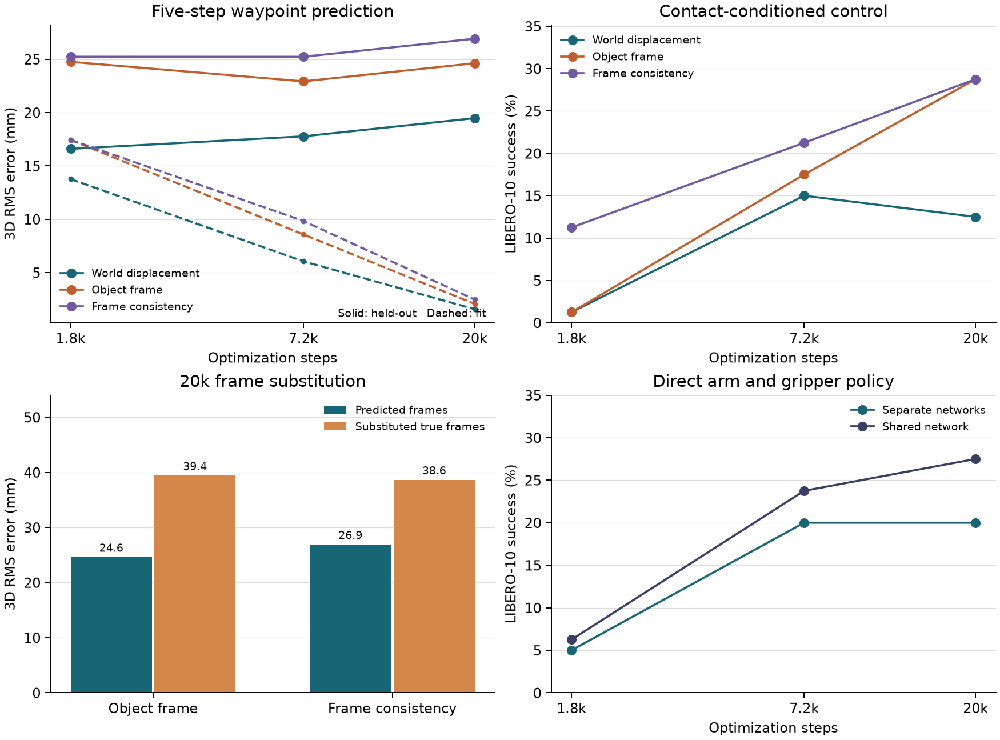

# 两路视觉、本体状态与单步操作 · LIBERO-10

## 训练到 20,000 步，混合控制如何改变任务成功数

四种网络，每种两个种子，均完成同一条 20k 学习率曲线。共纳入 **2,720 个闭环回合**，覆盖 40 个不同的任务和初态组合。配对核验发现一条回合的初始观测指纹与同组不符，使用同一 checkpoint 和初态重跑后指纹一致，两次均成功。原记录和重跑记录均在归档中的 `reset_replay_audit.json`。[逐检查点、种子与任务的汇总](summary.json) · [逐回合证据、标签与权重校验](evidence.tar.gz)

**执行器分工。** 两组均用六维手臂动作回归和单独的夹爪开合输出。在同一 80 个条件上，共享特征网络从 1,800 到 7,200 到 20,000 步成功 **5 → 19 → 22** 次，拆成两个可训练网络为 **4 → 16 → 16**。20k 时仅共享版成功 14 次，仅独立版成功 8 次，共享版在两个训练种子上分别净多 5 和 1 次。当前结果支持共享感知与状态特征。夹爪二值化相对于连续回归的效应仍需单独对照。

下表比较相同的 80 个回合条件（十项任务 × 四个官方初态 × 两个训练种子）。每个单元格是成功回合数。直接策略使用学习动作；其他四列只改变平移控制器的混合比例，沿用同一次训练的动作和感知网络。

| 20k 的目标表示 | 直接策略 | 固定 50/50 | 校准常数 | 估计接触决定权重 | 估计目标槽位与接触决定权重 |
| --- | ---: | ---: | ---: | ---: | ---: |
| 世界坐标位移 | 16 | 15 | 10 | 10 | 11 |
| 物体坐标系 | 23 | 17 | 26 | 23 | 25 |
| 物体坐标系加一致性损失 | 18 | 14 | 17 | 23 | 20 |

从 1,800 到 7,200 到 20,000 步，接触路由的成功数在世界坐标下是 **1 → 12 → 10**，在物体坐标下是 **1 → 14 → 23**，加一致性损失后是 **9 → 17 → 23**，每次均为相同的 80 个条件。仅用早期结果会高估一致性损失相对原物体坐标模型的收益。物体坐标模型的接触路由和校准常数在 20k 分别为 23/80、26/80，一致性模型的对应结果为 23/80、17/80。按配对回合统计，一致性模型上仅接触路由成功 12 次，仅常数成功 6 次；两个训练种子的净差各为 +7 和 −1。路由收益随底层模型与种子改变。

**示范与实际执行。** 世界坐标五步终点 RMS 在拟合示范上由 13.8 降至 6.1、1.6 mm，留出示范上则由 16.6 升至 17.8、19.5 mm。物体坐标模型 20k 的接触 F1 在留出示范上为 0.921，自身接触路由实际执行时为 0.691。物体及区域槽位的位置平均误差相应为 16.9 mm、63.0 mm。前者按专家轨迹采样，后者在每个实际规划时刻计量。闭环成功数与示范上的单一指标各自回答不同的问题。



## 可部署输入与评测隔离

每次神经规划只读固定外部相机、腕部相机和八维本体状态（末端位置、轴角、两指关节位置）。两台相机分别编码。所有任务共用同一策略，策略不读任务编号、指令、物体坐标、接触真值及模拟器目标谓词。动作头一次给出 40 步六轴机械臂和夹爪命令；执行五步后重规划。几何控制只替换这五步的平移，每个控制周期用最新末端位置闭环一次。真实物体位姿和接触分别用于训练标签和动作规划后的评测。[策略](../../src/lerobot/policies/demonstration_chunk/visual_geometry.py) · [闭环入口](../../scripts/one_step/eval_libero.py)

每任务 50 条示范按回合划为 32 条训练、8 条校准和 10 条测试。各版本均用同一冻结 GR00T N1.7 双视角视觉塔，在 LeRobot 框架内从随机权重训练动作头。训练使用 128 个窗口的批次、AdamW、单条 20,000 步余弦学习率曲线；在 1,800、7,200 和 20,000 步保存权重。训练种子为 1、42。同一种子各版本用同一训练窗口采样序列。校准集只拟合控制器混合权重。仿真回合最多 520 个控制周期。先在全部十任务的相同官方初态 12、13 上比较训练轨迹；接触路由及执行器分离对照的直接策略在三个检查点均另测初态 14、15，20k 的其余路由也评测这两个初态。对比时保留训练种子、任务和初态配对。[训练](../../scripts/one_step/train_visual_geometry.py)

直接策略还做了等参数量的执行器对照：共享版将手臂、夹爪和几何输出接在同一宽度 485 的网络上；分离版使用宽度 384 的手臂/几何网络及独立的宽度 224 的夹爪网络，两者仍接收同一冻结视觉塔的观测特征。两者均预测世界坐标位移，使用相同标签、损失、更新及初态。

## 怎样估计几何、接触和目标

每个任务用 BDDL 最终条件中出现的实体与区域定义最多四个监督槽位，按首次出现次序排列。训练用 MuJoCo 的 `states[t+1]` 为动作执行后的 `obs[t]` 重建标签，并用 `obs[t+5]` 给五步终点打标签。每槽预测三维位置、由两个正交基向量恢复的旋转、有效性和接触概率。接触指两个手指的碰撞几何与该实体或区域所属刚体的碰撞，重叠所有者可能令多个槽同时为真；它衡量物理触碰，持物稳定性需另测。所有几何 ID 经 `geom_name2id` 解析；早期按名称列表下标标注的试跑已排除。[标注](../../scripts/one_step/label_geometry.py)

- **世界坐标模型**从图像和本体状态回归相对当前末端的五步位移，同时训练物体位姿和接触辅助输出。
- **物体坐标模型**预测每个槽的物体坐标系偏移，并按推断的目标实体概率混合。其世界坐标终点为 `Σ qⱼ (pⱼ + Rⱼ oⱼ)`。旋转、位置、局部偏移和关联权重都来自策略观测。
- **坐标系一致性模型**具有完全相同的物体坐标网络和参数量。将训练终点损失均分给两种坐标换算：一次使用估计位姿，一次在有效槽位代入真实位姿，保持关联概率和局部偏移相同。推理始终使用估计位姿。这项后续对照来自前两种模型的留出诊断，应作为探索性复核解读。

每个 checkpoint 评测直接使用学习动作、固定 50/50、在校准集拟合的常数，以及由估计接触概率在两个已拟合权重间插值的路由。20k 另拟合按估计目标槽位与接触概率分配的权重，以检验更细的目标条件；校准时使用五步末端误差的线性动力学近似，槽位权重向接触路由收缩。[目标条件路由](../../scripts/one_step/calibrate_entity_gate.py)

## 为什么更准的物体坐标可能产生更差的动作目标

对单个物体，五步目标写为 `x = p + R o`。如果只监督终点，那么对任意局部平移 `d` 和旋转 `Q`，令 `p′ = p + R d`、`R′ = R Q`、`o′ = Qᵀ(o − d)`，得到完全相同的 `x`。终点损失本身无法唯一确定物体坐标系。本实验另外监督了世界位姿和局部偏移，因此可以测量训练后还剩多少相互补偿。

在 2,968 个留出窗口上，把误差逐窗口精确分成四个三维向量。取离专家五步终点最近的有效槽位，四项依次是软关联相对该槽的偏差、该槽平移误差、旋转误差作用于真实局部偏移，以及预测旋转作用于局部偏移误差。四项向量和等于预测终点减真实终点。20k 时，物体坐标模型的平移项与局部偏移项平均内积为 −431 mm²，旋转项与局部偏移项为 −782 mm²（两个种子的均值）。负交叉项使合成误差变小。[逐窗口恒等式与计算](../../scripts/one_step/decompose_waypoint.py)

| 留出终点 RMS，两个种子均值，mm | 1,800 步 | 7,200 步 | 20,000 步 |
| --- | ---: | ---: | ---: |
| 物体坐标，所有量由网络预测 | 24.8 | 22.9 | 24.6 |
| 同一模型，仅将有效槽的位置和旋转换成真值 | 45.7 | 39.0 | 39.4 |
| 坐标系一致性训练，所有量由网络预测 | 25.2 | 25.2 | 26.9 |
| 同一一致性模型，仅换入真实位姿 | 29.4 | 36.6 | 38.6 |

替换实验保留每个样本原有的槽位概率和局部偏移。20k 时，单独将软关联换为最近的真实槽位，原始物体坐标模型为 24.8 mm。真实位姿替换的代价在 1,800 步时受一致性训练明显抑制，训练到 20k 时两模型仍存在补偿。这里的目标是未来末端位置，最近的槽位是几何定义的代理标签，示范者的子目标没有独立标注。

## 两个控制器的混合权重能修正多少误差

在用于校准的五步线性动力学近似下，设学习控制器预测的平移与专家终点相差向量 `r = 专家位移 − 学习位移`，伺服与学习控制器的位移之差为 `δ`。混合控制能到达的点构成一条线段。当 `δ ≠ 0`，令 `α = clip(δᵀr / ‖δ‖², 0, 1)` 就得到线上最接近专家终点的一点。误差中垂直于 `δ` 的分量无法通过调整权重消除。当两种动作一致时，所有权重等价。

对 20k 的物体坐标模型，2,968 个留出窗口上的五步位移 RMS，两个种子取均值：校准常数为 18.44 mm，接触路由为 18.41 mm，目标槽位加接触为 18.43 mm。逐窗口给出真实未来终点后，最佳权重可达 16.02 mm，约 54% 的窗口的最优解在线段内部。由此可分开两个问题：两个控制器确有互补空间，而接触和槽位特征在该离线目标上仅利用了很少一部分。真值投影只用于计算下界，数值适用于这个五步动力学近似。复现时运行 `diagnose_gate_projection.py`，传入 `--root`、`--cache`、`--labels` 以及 `--out "$run/gate_projection.json"`。[投影诊断](../../scripts/one_step/diagnose_gate_projection.py)

## 复现入口

服务器路径为 `lerobot-gpu:/root/autodl-tmp/lerobot/outputs/visual_geometry_v2`。以下命令在远端仓库根目录执行；仿真 EGL 与资产库路径见[运行环境](../hybrid_control/REPRODUCE.md)。两路 RGB 的冻结特征复用 `outputs/chunk_aligned/cache`。不同任务可并行标注，不同种子和模型可分卡训练。每个训练检查点使用独立目录。

```bash
run=outputs/visual_geometry_v2
suite=/root/autodl-pub/datasets/libero/libero_10
assets=/root/autodl-tmp/libero-runtime/LIBERO-master/libero/libero/assets
uvbin=/root/autodl-tmp/lerobot-env/bin/uv
export PYTHONPATH=scripts/latency_test:scripts/operation_geometry
for task in {0..9}; do
  "$uvbin" run --no-sync python scripts/one_step/label_geometry.py \
    --suite "$suite" --assets "$assets" --task "$task" --out "$run/labels"
done
"$uvbin" run --no-sync python scripts/one_step/train_visual_geometry.py \
  --geometry consistent --seed 1 --cache outputs/chunk_aligned/cache --labels "$run/labels" --out "$run"
"$uvbin" run --no-sync python scripts/one_step/calibrate_entity_gate.py \
  --geometry consistent --seed 1 --cache outputs/chunk_aligned/cache --labels "$run/labels" --root "$run/step20000/seed1"
"$uvbin" run --no-sync python scripts/one_step/eval_libero.py \
  --root "$run/step20000/seed1" --variant consistent_entity_contact --seed 1 --first-state 14 --episodes 2 \
  --suite "$suite" --libero-assets "$assets" --checkpoint /root/autodl-pub/checkpoints/groot/n1.7-3b \
  --out "$run/step20000/seed1/consistent_entity_contact-s14"
```

对世界位移、物体坐标、坐标系一致性和共享网络分别指定 `--geometry world/object/consistent/shared`（每次选一个），每种训练种子 1 和 42。用 `diagnose_visual_geometry.py --geometry <模型> --seed <种子> --cache outputs/chunk_aligned/cache --labels "$run/labels" --root "$run" --out "$run/diagnostic-<模型>-<种子>.json"` 比较拟合、校准和留出轨迹。把同任务其他示范的两路图像同时换入，保留本体状态，衡量模型对视觉的依赖。坐标替换用 `decompose_waypoint.py`，传入相同的缓存、标签与根目录，对两个物体坐标版本分别输出 `decomposition.json` 和 `decomposition-consistent.json`。完成各组闭环后，运行 `summarize_visual_geometry.py --root "$run" --out "$run/summary.json"` 核验同一任务和初态的重置指纹、每个回合的规划次数以及各组分母。以上脚本均位于 `scripts/one_step/`。

机器人视觉特征与相对空间位移已有相关研究。本实验比较的是推断坐标系和局部动作是否协同产生误差，以及这种协同如何随训练时间改变。[Deep Spatial Autoencoders](https://arxiv.org/abs/1509.06113) · [Transporter Networks](https://arxiv.org/abs/2010.14406)
